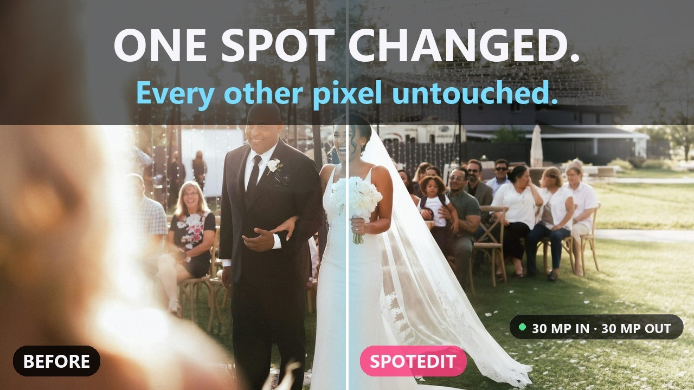
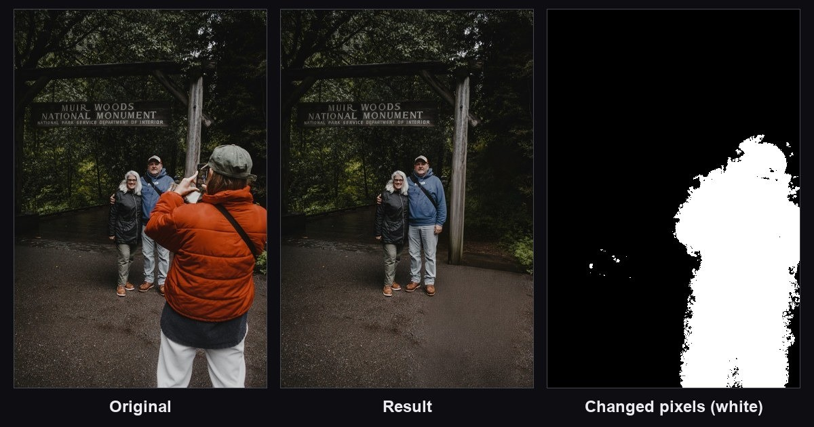
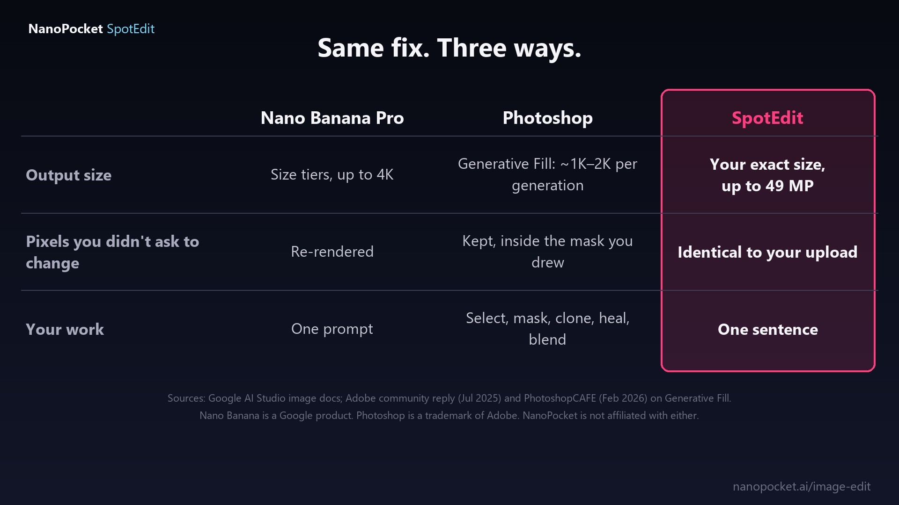
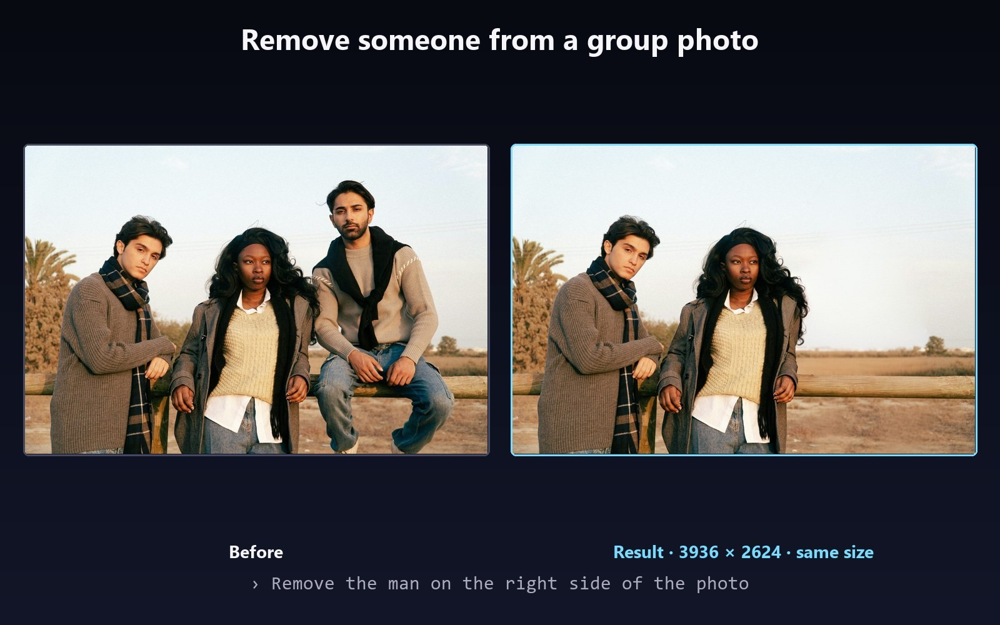
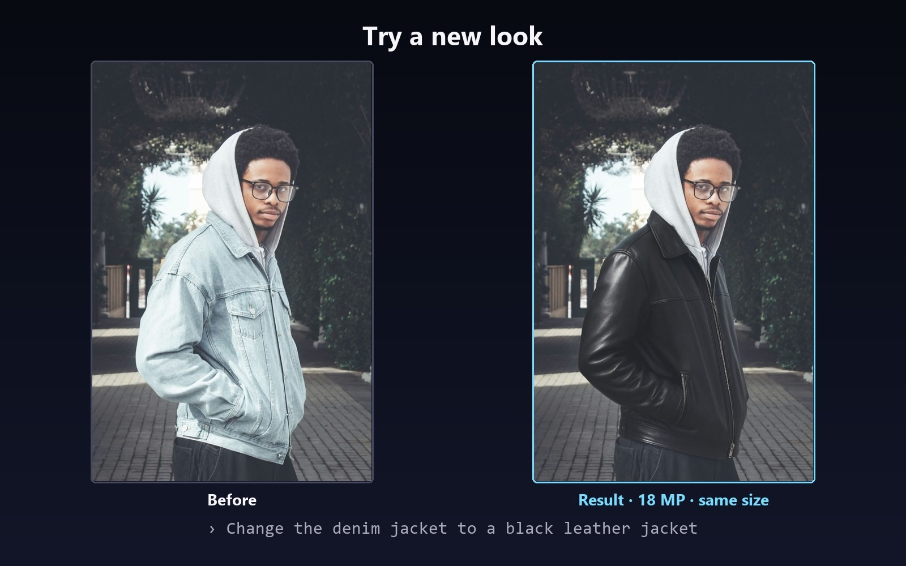
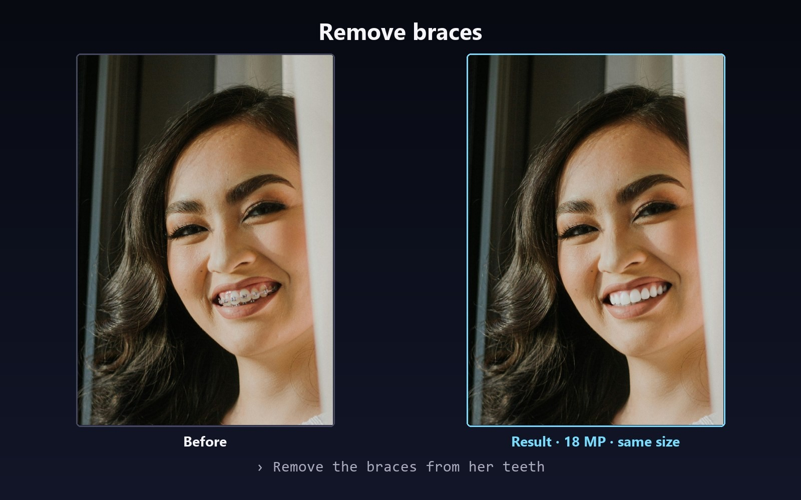
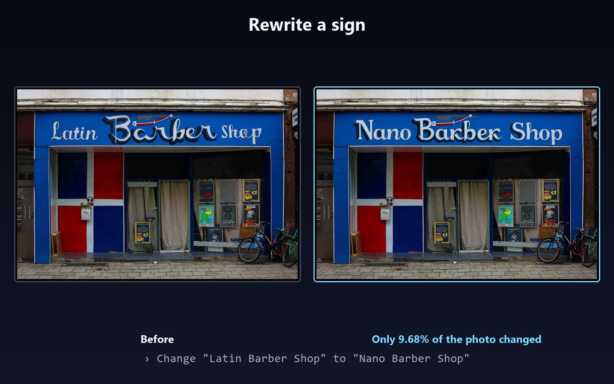
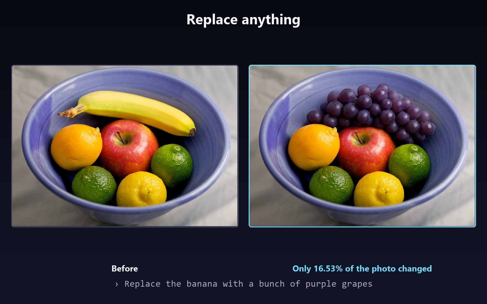
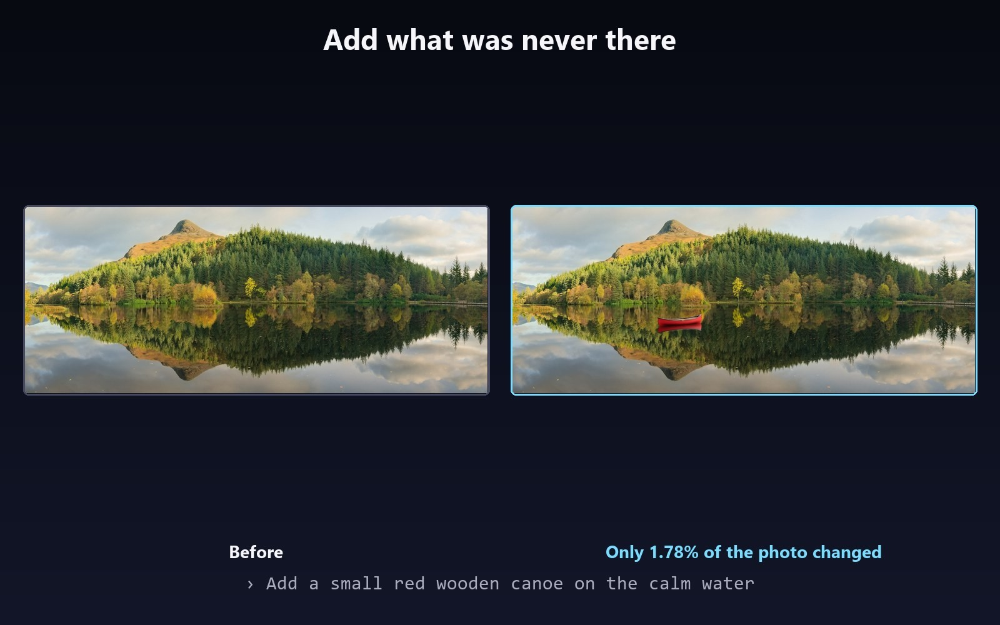

# NanoPocket · SpotEdit – Change One Spot, Keep Every Other Pixel

### Say the change in one sentence. Only that spot changes, at your photo's full resolution.

   

## 🎬 Demo video

▶️ **[Watch on YouTube](https://youtu.be/JOsz27Qewkc)**

## ✨ About SpotEdit

Asked an AI for one small fix and got back a slightly different photo? General image models such as Nano Banana redraw the whole picture, so skin, grain and background drift, and the result comes back at the model's size, not yours. Photoshop keeps your pixels, but only after you select, mask, clone, heal and blend. SpotEdit does the fix from one sentence and touches nothing else: every pixel outside the edit is identical to your upload, and the photo comes back at its own resolution, up to 49 MP, never scaled down or upscaled.

- Your size, not ours: native resolution up to 49 MP. Nothing is scaled down, scaled up or rebuilt
- Pixels you didn't ask to change stay identical to your upload, and the pixel map proves it
- No masks, no clone stamp: one sentence does it. Painting an area is optional
- Say what you imagine: remove people, change outfits, replace objects, add new ones, rewrite a sign
- Edit again and again without drift, because each edit leaves the rest alone
- Lossless PNG out; colour profile and EXIF kept
- From 30 credits per edit, failed edits are free, 100 free credits for new accounts, no subscription

## 🚀 Try it now

- **Try SpotEdit: [nanopocket.ai/image-edit](https://nanopocket.ai/image-edit)**
- **SpotEdit vs Photoshop, Nano Banana & FLUX: [nanopocket.ai/blog/ai-retouching-vs-photoshop](https://nanopocket.ai/blog/ai-retouching-vs-photoshop)**

## 🖼 Highlights

<table><tr><td align="center" valign="top" width="50%"> <b>The pixel check: white is the only part that changed</b></td><td align="center" valign="top" width="50%"> <b>Same fix, three ways</b></td></tr></table>

<table><tr><td align="center" valign="top" width="50%"> <b>Remove someone from a group photo (10 MP in, 10 MP out)</b></td><td align="center" valign="top" width="50%"> <b>Try a new look (18 MP)</b></td></tr></table>

<table><tr><td align="center" valign="top" width="50%"> <b>Remove braces (18 MP)</b></td><td align="center" valign="top" width="50%"> <b>Rewrite a sign: only 9.68% of the photo changed</b></td></tr></table>

<table><tr><td align="center" valign="top" width="50%"> <b>Replace anything. Sorry, Nano Banana.</b></td><td align="center" valign="top" width="50%"> <b>Add what was never there: only 1.78% changed</b></td></tr></table>

## 🏢 About NanoPocket

NanoPocket builds generative AI creative tools for images, video and faces. Use them online in your browser, or as desktop apps that run 100% locally on your own GPU, so your data never leaves your machine. The suite covers AI photo retouching, video face swap and head swap, facial editing, virtual try-on, image generation and editing, image and video upscaling, and AI video generation.

## 🔗 Links

- **Website:** https://nanopocket.ai
- **Download:** https://nanopocket.ai/download
- **Hugging Face:** https://huggingface.co/Nanopocket-ai
- **YouTube:** https://www.youtube.com/@NanoPocket_ai
- **GitHub:** https://github.com/Nanopocket-ai
- **Contact:** tech@nanopocket.ai

---

All examples are real SpotEdit edits, not retouched afterwards. Competitor figures: Google AI Studio image docs; Adobe community reply (Jul 2025) and PhotoshopCAFE (Feb 2026) on Generative Fill; see the comparison guide for links. Nano Banana is a Google product, FLUX is from Black Forest Labs and Photoshop is a trademark of Adobe; NanoPocket is not affiliated with them. Results from accounts that have never bought credits carry a watermark. Example photos are used under their original licences: Unsplash, and Wikimedia Commons (&quot;Barber Storefront with Flag&quot;, CC BY-SA 3.0; &quot;Fruit Bowl (4880797613)&quot;, CC BY 2.0; &quot;Glencoe Lochan reflections 3&quot;, CC BY-SA 3.0).

© 2026 NanoPocket. All rights reserved. Synced automatically from https://nanopocket.ai.
